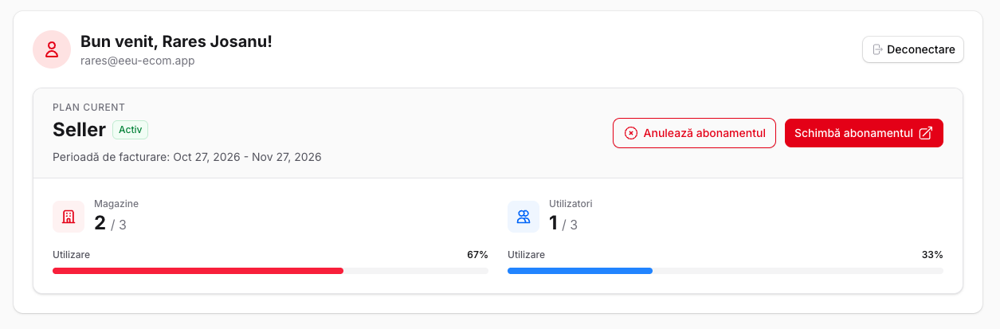

Secțiunea **Dashboard** (Panou de control) este pagina principală din Master Admin. Aici vezi abonamentul CMS și cât din el folosești:

- **Plan curent** și **Perioadă de facturare**
- **Utilizare**: numărul de magazine și de utilizatori, față de limita planului (sau „nelimitat” în Advanced)
- butoanele **Schimbă abonamentul** și **Anulează abonamentul**

Dacă ai mai multe magazine sau utilizatori activi decât permite planul (de exemplu după un downgrade), în partea de sus a paginilor apare un avertisment că resursele suplimentare vor fi dezactivate în curând. Vezi [Abonamente](/cms/abonamente).

<Frame caption="Dashboard-ul Master Admin">
  
</Frame>
