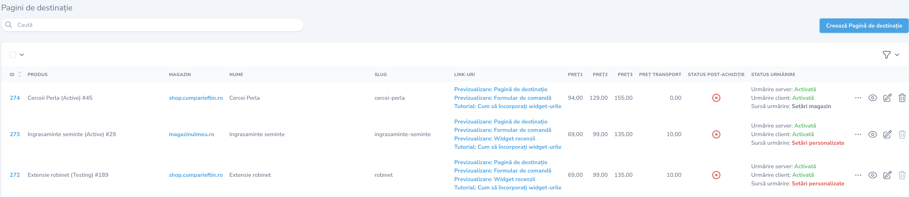
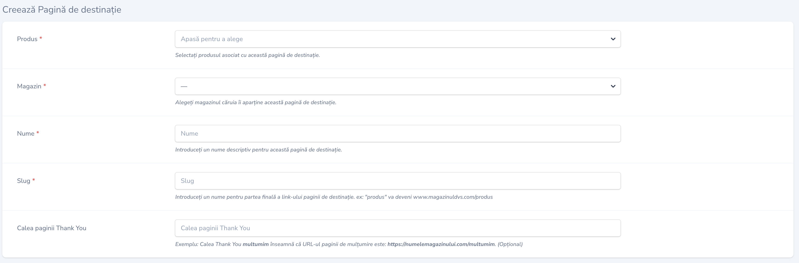
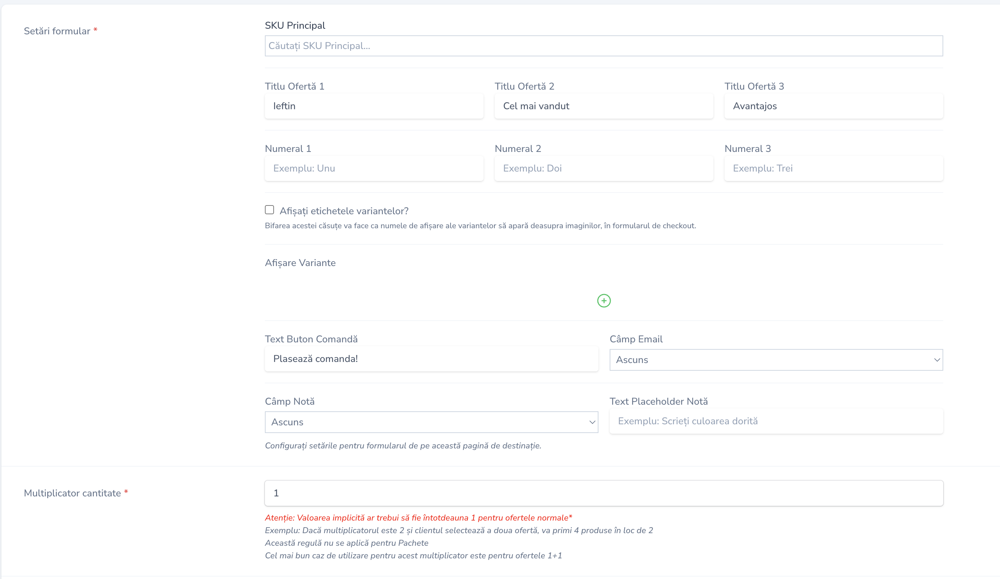
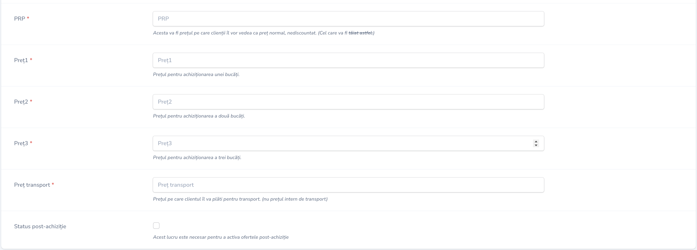
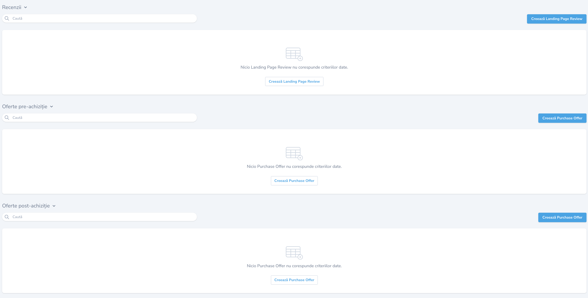

Pagina **Pagini de destinație** (Landing Pages) permite gestionarea paginilor tale de vânzare. Aici poți crea și configura pagini de destinație pentru produsele tale, seta oferte, prețuri și opțiuni de personalizare.

## Tabel pagini de destinație

Tabelul afișează toate paginile de destinație configurate cu următoarele informații:

<Frame caption="Tabel pagini de destinație">

</Frame>

### Coloane disponibile

- **ID** - ID-ul paginii de destinație în sistem
- **Pagină** - Numele paginii (îngroșat), produsul cu eticheta statusului său (Active, Testing, Leftover, Paused) și link-ul `magazin/slug`, care deschide pagina într-un tab nou
- **Link-uri** - Link-urile pentru previzualizare formular și widget recenzii + tutoriale pentru utilizare
- **Prețuri** - Prețurile pentru **1 buc.**, **2 buc.**, **3 buc.** și **Livrare**, în moneda magazinului. Dacă SRP-ul este mai mare decât prețul pentru o bucată, apare tăiat lângă el.
- **Status post achizitie** - Dacă pagina are activate ofertele post achizitie (planul Gold)
- **Status urmărire** - Configurarea tracking-ului (Sursă urmărire și Status)

### Filtre

- **Filtru Status Pagină de Destinație**: **Activ** sau **Testare**, după statusul produsului paginii
- **Filtru Magazin Pagină de Destinație**: paginile unui anumit magazin

### Sursă urmărire

Coloana **Sursă urmărire** indică de unde provin setările de tracking:

- **Setări magazin** - Se folosesc setările implicite de la nivel de magazin
- **Setări personalizate** - Pagina folosește setări proprii de tracking, diferite de cele ale magazinului

<Info>
Dacă tracking-ul a fost setat la nivel de magazin, nu este necesar să fie setat și la nivel de landing page. Setările se vor prelua automat de la magazin. Setările personalizate sunt necesare doar când dorești ca acea pagină să aibă un alt pixel sau token API conversii diferit față de celelalte pagini din magazin.
</Info>

### Acțiuni disponibile

Pentru fiecare pagină de destinație din tabel, sunt disponibile următoarele acțiuni:

- **Vizualizare detalii** (iconița **ochi**) - Accesează pagina de detalii pentru a gestiona recenzii și oferte pre/post-achiziție
- **Editare** - Modifică setările paginii de destinație
- **Ștergere** - Șterge pagina de destinație

## Creare pagină de destinație

### Informații de bază

<Frame caption="Formular creare pagină - Informații de bază">

</Frame>

#### Produs
Selectează produsul asociat cu această pagină de destinație.

#### Magazin
Alege magazinul responsabil căruia îi aparține această pagină de destinație.

#### Nume
Introdu un nume descriptiv pentru această pagină de destinație.

<Tip>
Folosește un nume sugestiv care te ajută să identifici rapid pagina (ex: "Produs Premium - Campanie Vara 2026").
</Tip>

#### Slug
Introdu un nume pentru calea finală a slide-ului paginii de destinație (ex: "produs" va deveni magazinulmeu.com/produs).

<Warning>
Slug-ul trebuie să fie unic și să conțină doar litere mici, cifre și cratime. Nu folosi spații sau caractere speciale.
</Warning>

#### Versiune formular
Aspectul formularului de comandă: **Original** (implicit) sau **Modern**. Câmpurile și funcționarea sunt aceleași în toate versiunile.

#### Calea paginii Thank You
Exemplu: Calea Thank You `/multumim-frumos` va direcționa clientul pe pagina `magazinulmeu.ro/multumim-frumos` după plasarea comenzii.

⚠️ **Pentru utilizatorii CMS:** Calea Thank You este `/thank-you`. Momentan această pagină nu poate fi customizată dar acest lucru va fi implementat în curând. În cazul paginilor cu oferte post-achiziție, widget-ul este afișat automat pe această pagină.

<Info>
Pagina Thank You este pagina pe care clientul o vede după ce a plasat comanda cu succes. Aici poți afișa mesaje de confirmare, oferte suplimentare sau instrucțiuni pentru client.
</Info>

## Setări ofertă

<Frame caption="Formular creare pagină - Setări ofertă">

</Frame>

Secțiunea **Setări ofertă** conține, în ordine: **Setări formular**, **Schemă de culori**, multiplicatorul de cantitate și prețurile.

### Setări formular

Câmpul **Setări formular** are cinci părți, fiecare cu previzualizare.

#### Varianta preselectată
Produsul selectat automat când clientul deschide formularul. Caută SKU-ul printre **Variante Produs** și **Pachete**. Varianta preselectată trebuie să fie printre variantele afișate în formular.

#### Oferte de cantitate
Textele celor 3 carduri de ofertă (1, 2 și 3 bucăți): pentru **Oferta 1**, **Oferta 2** și **Oferta 3** completezi **Etichetă** (ex: "Cel mai vândut") și **Text cantitate** (ex: "Doi"). Prețurile se setează mai jos, la **Prețuri**.

#### Variante în formular
Variantele dintre care alege clientul (culoare, mărime...), în ordinea afișării. Pentru fiecare alegi **SKU**-ul și **Nume Afișare** (maxim 20 de caractere). Ordinea se schimbă cu **Mută mai sus** / **Mută mai jos**, iar o variantă nouă se adaugă cu **Adaugă variantă**.

Comutatorul **Afișează numele pe imagini** afișează numele variantelor deasupra imaginilor în formular.

#### Câmpuri suplimentare
Pentru **Email**, **Cod poștal** și **Notă de la client** alegi **Ascuns**, **Opțional** sau **Obligatoriu**. Dacă nota nu este ascunsă, poți seta și **Text Placeholder Notă**.

<Tip>
Nu recomandăm câmpul de email obligatoriu: mulți clienți nu folosesc adrese de email, iar rata de conversie poate scădea.
</Tip>

#### Butonul de comandă
Textul de pe butonul care trimite comanda (ex: "Plasează comanda!"), cu previzualizare alături. Gol înseamnă textul implicit, în limba formularului.

### Schemă de culori

Personalizează culorile formularului de comandă:

- **Culoarea primară** - Culoarea principală a formularului
- **Culoarea accent** - Culoarea pentru butoane și elemente interactive
- **Culoarea fundal** - Culoarea de fundal a formularului

Dacă nu modifici aceste culori, pagina preia schema de culori a magazinului.

### Multiplicator cantitate

Valoarea implicită este 1. Dacă dorești să afișezi oferte în care cantitatea este multiplicată, poți seta această valoare.

Exemplu: Setând valoarea la 2, clienții vor primi 2 / 4 / 6 unități în loc de 1 / 2 / 3.

### Prețuri

#### Preț 1, Preț 2, Preț 3
Setează prețurile pentru cele 3 oferte disponibile.

<Warning>
Asigură-te că prețul pentru oferta 3 se împarte exact la 3 pentru a evita erori de afișare a prețurilor.
</Warning>

#### Preț transport
Setează prețul pentru transportul produsului (poate fi 0 pentru transport gratuit).

#### Status post achiziție
Selectează dacă dorești ca ofertele post-achiziție să fie afișate pe pagina de mulțumire.

<Info>
Ofertele pre-achiziție și post-achiziție sunt disponibile începând cu planul **Gold**.
</Info>

<Frame caption="Formular creare pagină - Prețuri și personalizare">

</Frame>

## Urmărire conversii

Configurează urmărirea conversiilor pentru această pagină de destinație.

### ID Facebook Pixel
Introdu ID-ul Facebook Pixel pentru urmărire (opțional - se va folosi cel de la magazin dacă nu este completat).

### Token API conversii
Introdu token-ul API pentru conversii Facebook (opțional - se va folosi cel de la magazin dacă nu este completat).

### ID TikTok Pixel
Introdu ID-ul TikTok Pixel pentru urmărire (opțional - se va folosi cel de la magazin dacă nu este completat).

### Urmărire client-side activată (Facebook & TikTok Pixel)
Bifează această opțiune pentru a instala automat codul Facebook și TikTok Pixel pe această pagină.

### Urmărire server-side activată (API conversii)
Bifează această opțiune pentru a activa urmărirea server-side prin API-ul de conversii.

### Nume eveniment conversie (opțional)
Setează un nume personalizat pentru evenimentul de conversie.

<Info>
**Setări implicite:** Dacă nu completezi câmpurile de tracking, pagina va folosi automat setările configurate la nivel de magazin. Completează aceste câmpuri doar dacă dorești să folosești pixeli sau token-uri diferite pentru această pagină specifică.
</Info>

<Warning>
Folosirea de setări personalizate de tracking pentru fiecare pagină poate complica raportarea. Recomandăm să folosești setările de la nivel de magazin pentru consistență, cu excepția cazurilor în care ai nevoie de tracking separat pentru campanii specifice.
</Warning>

## Gestionare recenzii și oferte

Pentru a accesa funcționalitățile de recenzii și oferte pre/post-achiziție, apasă pe iconița **ochi** (Vizualizare detalii) din tabelul de pagini de destinație pentru landing page-ul dorit.

<Frame caption="Pagina de detalii - Recenzii și oferte">

</Frame>

Pagina de detalii conține trei secțiuni principale:
- **Recenzii** - Gestionarea recenziilor afișate pe pagina de destinație
- **Oferte pre-achiziție** - Configurarea ofertelor upsell din formular
- **Oferte post-achiziție** - Configurarea ofertelor upsell de pe pagina de mulțumire

### Recenzii

<Info>
Funcționalitatea de recenzii este disponibilă începând cu planul **Starter**.
</Info>

Recenziile sunt afișate în widget-ul de recenzii de pe pagina de destinație și ajută la creșterea încrederii clienților.

#### Adăugare recenzie

Pentru a adăuga o recenzie nouă, apasă butonul **"Creează Landing Page Review"** și completează formularul:

**Câmpuri formular:**

- **Name** - Numele autorului recenziei
- **Author** - Autorul recenziei (poate fi același cu Name sau diferit)
- **Comment** - Textul recenziei (comentariul clientului)
- **Timestamp** - Folosește 1z / 3sapt. / 1lun. pentru a face recenziile mai credibile și asemănătoare ca cele reale de pe Facebook
- **Likes** - Numărul de like-uri pentru recenzie
- **Heart reacts** - Numărul de reacții cu inimă
- **Care reacts** - Numărul de reacții de îngrijorare
- **Replied count** - Numărul de răspunsuri la recenzie
- **Comment photo** - Fotografie atașată recenziei (opțional)
- **Landing Page** - Pagina de destinație la care se atașează recenzia

<Tip>
Pentru a face recenziile mai credibile, variază numărul de like-uri, reacții și răspunsuri. Folosește timestamp-uri realiste și adaugă fotografii când este posibil.
</Tip>

#### Previzualizare recenzii

După ce ai adăugat recenzii, le poți previzualiza accesând link-ul din coloana **"Link-uri utile"** din tabelul de pagini de destinație.

<Info>
Widget-ul de recenzii afișează doar comentariile, fără antetul cu stele și numărul de recenzii.
</Info>

### Oferte pre-achiziție

<Info>
Ofertele pre-achiziție și post-achiziție sunt disponibile începând cu planul **Gold**.
</Info>

Ofertele pre-achiziție sunt upsell-uri afișate în formularul de comandă, înainte ca clientul să finalizeze comanda.

#### Adăugare ofertă pre-achiziție

Pentru a adăuga o ofertă pre-achiziție, apasă butonul **"Creează Purchase Offer"** din secțiunea **"Oferte pre-achiziție"** și completează formularul:

**Câmpuri formular:**

- **Landing Page** - Pagina de destinație la care se atașează oferta (pre-completat)
- **Type** - Tipul ofertei: **Pre-achiziție** sau **Post-achiziție**
- **Vendable** - Produsul ofertat: **Variantă produs** sau **Bundle** (pachet)
- **Variantă/Bundle** - Selectează varianta de produs sau bundle-ul specific
- **Title** - Titlul ofertei (ex: "Adaugă un creion extra!")
- **Description** - Descrierea ofertei (detalii despre produs sau beneficii)
- **Quantity** - Cantitatea oferită
- **SRP** - Prețul recomandat de vânzare (cel tăiat)
- **Price** - Prețul ofertei
- **Active** - Bifează pentru a activa oferta
- **Media** - Imagine pentru ofertă
- **Display Order** - Ordinea de afișare (pentru multiple oferte). Ofertele cu Display Order mai mic sunt afișate mai sus.

<Tip>
Pentru ofertele pre-achiziție, folosește prețuri atractive și descrieri clare care evidențiază beneficiile produsului adăugat. Testează diferite variante folosind câmpul Split.
</Tip>

### Oferte post-achiziție

Ofertele post-achiziție sunt upsell-uri afișate pe pagina de mulțumire, după ce clientul a plasat comanda inițială.

#### Adăugare ofertă post-achiziție

Pentru a adăuga o ofertă post-achiziție, apasă butonul **"Creează Purchase Offer"** din secțiunea **"Oferte post-achiziție"** și completează formularul cu aceleași câmpuri ca la ofertele pre-achiziție, dar selectând **Type: Post-achiziție**.

**Diferențe față de ofertele pre-achiziție:**

- Ofertele post-achiziție apar pe pagina de mulțumire, după plasarea comenzii
- Clientul trebuie să confirme adăugarea produselor post-achiziție
- Comenzile cu produse post-achiziție neconfirmate rămân în status **New** până la confirmare

<Warning>
Comenzile cu oferte post-achiziție neconfirmate nu sunt trimise automat în Helpship. Trebuie să confirmi sau să elimini produsele post-achiziție din pagina [Comenzi](/crm/orders) pentru a procesa comanda.
</Warning>

<Info>
Pentru a activa afișarea ofertelor post-achiziție pe pagina de mulțumire, asigură-te că ai setat **Status post achiziție** la crearea/editarea paginii de destinație.
</Info>

#### Gestionare oferte post-achiziție în comenzi

Ofertele post-achiziție pot avea următoarele statusuri în comenzi:

- **None** - Nu există produse post-achiziție în comandă
- **Confirmed** - Clientul a confirmat produsele post-achiziție
- **Unconfirmed** - Clientul nu a confirmat produsele post-achiziție

Pentru mai multe detalii despre gestionarea comenzilor cu oferte post-achiziție, consultă pagina [Comenzi](/crm/orders).

### Bune practici pentru recenzii și oferte

#### Recenzii
- Adaugă recenzii autentice și variate
- Folosește fotografii reale când este posibil
- Variază timestamp-urile pentru a părea natural
- Menține un ton pozitiv dar realist
- Actualizează recenziile periodic

#### Oferte pre-achiziție
- Oferă produse complementare relevante
- Folosește prețuri atractive (reduceri clare)
- Limitează numărul de oferte (1-3 maxim)
- Testează diferite variante cu Split testing
- Asigură-te că imaginile sunt de calitate

#### Oferte post-achiziție
- Oferă produse care completează comanda inițială
- Folosește descrieri clare și beneficii evidente
- Setează prețuri competitive
- Monitorizează rata de confirmare
- Contactează clienții cu oferte neconfirmate

<Tip>
Pentru cele mai bune rezultate, combină recenzii autentice cu oferte relevante și bine poziționate. Testează diferite combinații pentru a găsi ce funcționează cel mai bine pentru publicul tău.
</Tip>

## Bune practici

### Denumire și organizare
- Folosește nume descriptive pentru pagini care includ produsul și campania
- Păstrează slug-urile scurte și relevante
- Organizează paginile pe magazine pentru o gestionare mai ușoară

### Configurare oferte
- Testează diferite combinații de prețuri pentru cele 3 oferte
- Asigură-te că oferta 2 sau 3 este cea mai atractivă (de obicei cea mai populară)
- Setează prețul de transport corect pentru a evita confuziile

### Personalizare vizuală
- Aliniază culorile cu identitatea brandului tău
- Testează schema de culori pe diferite dispozitive
- Asigură-te că textul este lizibil pe toate fundalurile

### Urmărire conversii
- Folosește setările de la magazin pentru consistență
- Creează setări personalizate doar pentru campanii speciale
- Verifică că pixelii funcționează corect înainte de a lansa campanii
- Monitorizează calitatea datelor în platformele de advertising

### Optimizare conversii
- Testează diferite texte pentru butonul de comandă
- Experimentează cu afișarea/ascunderea câmpului de email
- Oferă variante upsell/cross-sell relevante
- Creează pagini Thank You personalizate pentru fiecare campanie

<Tip>
Pentru cele mai bune rezultate, creează pagini de destinație separate pentru fiecare campanie majoră. Acest lucru îți permite să testezi și să optimizezi fiecare pagină independent.
</Tip>
