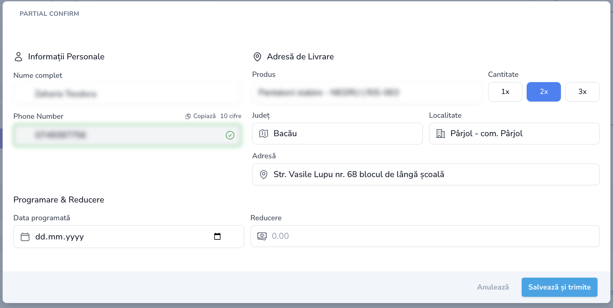

Pagina **Parțiale** conține toate comenzile parțiale făcute de clienți care nu au ajuns la pasul final al procesului de vânzare. Acești clienți de obicei întâmpină dificultăți în plasarea unei comenzi și au nevoie de asistență telefonică pentru a finaliza comanda.

<Warning>
Asigură-te că Parțialul pe care urmează să lucrezi are cel puțin **10 minute vechime**, altfel ar putea fi vorba de un client care încă completează formularul de checkout.
</Warning>

## Widget-ul de recuperare

Pe planul **Gold Plus**, deasupra listei de parțiale apare un widget pe toată lățimea paginii, cu rezultatele recuperării pe perioada aleasă. Descrierea lui, la final, rezumă rolul: formulare începute și netrimise, sunate de call center, ce se recuperează, ce așteaptă și când merită sunat.

Butonul **Restrânge Dashboard-ul** / **Extinde Dashboard-ul** ascunde sau afișează widget-ul.

### Filtre

- **Perioadă**: **Azi** (implicit), **Ieri**, **Ultimele 3 Zile**, **Săptămâna Curentă**, **Luna Curentă**, **Tot Timpul**
- **Data Început** / **Data Sfârșit**
- **Landing Page**: o pagină anume sau **Toate Landing Page-urile**

Apasă **Aplică Filtrele** ca să actualizezi datele. Rezultatele sunt păstrate în cache 15 minute.

### Cifre

| Card | Ce arată |
| --- | --- |
| **Parțiale** | Toate parțialele din perioadă și câte sunt încă în așteptare. Când există parțiale în așteptare, link-ul **Deschide** deschide lista filtrată pe **Pending**, cele mai vechi primele. |
| **Rată Acceptare** | Acceptate ÷ (acceptate + refuzate + fără răspuns): procentul de reușită din parțialele la care agentul a obținut un rezultat. |
| **Rată conversie** | Acceptate ÷ toate parțialele din perioadă (fără cele de test și duplicate): câte comenzi aduc, în total, parțialele. |
| **Venit recuperat** | Suma comenzilor obținute din parțiale acceptate, fără comenzile anulate. |
| **Valoare Medie** | Valoarea medie a unei comenzi recuperate. |
| **Rată Returnare Partiale** | Rata de neridicare a comenzilor venite din parțiale, cu numărul celor încă în livrare. |

<Info>
**Rata de acceptare** arată cât de bine lucrează call center-ul cu parțialele sunate. **Rata de conversie** arată cât recuperezi din toate parțialele, inclusiv cele încă nesunate sau amânate. Diferența mare între ele înseamnă de obicei multe parțiale încă în așteptare.
</Info>

### Reapeluri și curățare

- **De resunat (later)**: câte parțiale sunt acum marcate **Later**, indiferent de perioadă, cu link-ul **Deschide** către lista lor (cele mai vechi primele). Cardul te avertizează câte expiră în curând: parțialele **Later** neatinse de peste 7 zile sunt marcate refuzate la următoarea curățare.
- **Curăță Partiale**: rulează curățarea descrisă [mai jos](#curăță-parțiale) și arată câte parțiale au fost eliminate și câte au fost marcate refuzate.

### Agenți

Tabelul are câte un rând pentru fiecare utilizator, după cine a setat ultimul status al parțialului: **Procesate**, **Acceptate**, **Refuzate**, **Fără răspuns**, **Mai târziu**, **Duplicate**, **Rată Acceptare**, **În 1h** (procentul parțialelor rezolvate în prima oră de la intrare) și **Venit recuperat**. Ultimul rând este totalul.

### Grafice

Graficele apar doar când perioada are mai mult de o zi:

- **Distribuție Status**: acceptate, refuzate, fără răspuns, mai târziu și duplicate.
- **Tendințe Rată Acceptare**: evoluția ratei de acceptare **În Timp** sau **Pe Landing Page**.
- **Viteza de apel**: timpul de la intrarea parțialului până la rezultatul agentului, pe intervale (sub 15 min, 15–60 min, 1–6 h, 6–24 h, peste 24 h), cu câte au devenit comenzi. Sus vezi procentul **rezolvate în prima oră** și **timp mediu**.

<Note>
Timpii sunt aproximativi: se măsoară până la ultima modificare a parțialului, nu până la primul apel.
</Note>

<Info>
Pe planurile sub **Gold Plus**, deasupra listei apar carduri mai simple: parțialele în așteptare, statusul parțialelor modificate azi și cardul de curățare (**Rulează curățarea**).
</Info>

## Curăță parțiale

Curățarea face două lucruri:

- **șterge** parțialele în așteptare pentru care clientul a plasat deja comanda;
- marchează ca **refuzate** parțialele **Later** neatinse de peste 7 zile.

Curățarea nu rulează automat: pornește doar când apeși butonul.

<Tip>
Recomandăm utilizatorilor să ruleze mai întâi **"Curăță parțiale"** înainte de a începe lucrul cu parțialele (apelarea comenzilor parțiale).
</Tip>

## Ciclu de viață al statusului parțialelor

### Pending
Acesta este statusul implicit pe care îl au toate parțialele la început.

### Later
Acest status poate fi folosit pentru a marca parțialele care trebuie apelate mai târziu, de obicei, pentru că nu răspund sau cer să revii mai târziu.

### Confirmed
Acest status înseamnă că parțialul a fost confirmat cu succes, deoarece clientul a acceptat.

### Refused
Acest status înseamnă că clientul a refuzat comanda.

### Duplicate
Acest status înseamnă că parțialul este duplicat sau că clientul are deja o comandă în așteptare.

### Unanswered
Acest status este de obicei folosit pentru parțialele care au fost marcate anterior ca **later** și nu au răspuns după 2 sau 3 încercări de apel.

## Acțiuni disponibile pentru parțiale

Acțiunile pot fi executate făcând click pe cele **3 puncte** de pe partea dreaptă a rândului unui parțial, similar cu acțiunile din pagina [Comenzi](/crm/orders#acțiuni-disponibile-pentru-comenzi).

### Partial Confirm

Aceasta este cea mai importantă acțiune din această secțiune. Va afișa o fereastră modală cu câmpuri de adresă și selecționare a cantităților și variantelor disponibile.

<Frame caption="Modal confirmare parțiale">

</Frame>

**Înainte de a trimite parțialul mai departe, persoana care se ocupă de el trebuie să:**

1. Completeze câmpurile de adresă
2. Selecteze cantitățile și variantele dorite
3. Verifice informațiile de contact
4. Confirme comanda

<Info>
După confirmarea unui parțial, acesta va fi transformat automat într-o comandă completă și va apărea în pagina [Comenzi](/crm/orders).
</Info>

<Info>
**Marchează pentru mai tărziu**, **Marchează parțial duplicat** și **Marchează parțial nerăspuns** sunt disponibile începând cu planul **Silver**. **Refuzare parțial** este disponibilă pe orice plan. În fereastra **Partial Confirm**, programarea livrării și verificarea în lista neagră sunt disponibile tot din **Silver**.
</Info>

### Marchează pentru mai tărziu

Marchează parțialul pentru a fi apelat mai târziu. Util când clientul nu răspunde sau solicită să fie contactat la o altă oră.

### Refuzare parțial

Marchează parțialul ca refuzat când clientul refuză oferta.

### Marchează parțial duplicat

Marchează parțialul ca duplicat când identifici că există deja o comandă pentru acest client sau că parțialul este duplicat.

### Marchează parțial nerăspuns

Marchează parțialul ca nerăspuns după multiple încercări de contact.

## Bune practici

- **Verifică vechimea parțialului** - Așteaptă cel puțin 10 minute înainte de a contacta clientul
- **Rulează Clean-Up** - Curăță duplicatele înainte de a începe lucrul
- **Documentează încercările** - Notează de câte ori ai încercat să contactezi clientul
- **Fii persistent** - Încearcă să contactezi clientul de 2-3 ori înainte de a marca parțialul ca "unanswered"
- **Oferă asistență** - Mulți clienți au nevoie doar de ajutor pentru a completa comanda

## Workflow recomandat

1. Rulează **Clean-Up**
2. Filtrează parțialele cu status **Pending**
3. Verifică vechimea parțialului (minim 10 minute)
4. Contactează clientul telefonic
5. Folosește acțiunea corespunzătoare în funcție de răspuns:
   - **Confirm** - Dacă clientul acceptă
   - **Later** - Dacă clientul cere să fie contactat mai târziu
   - **Refused** - Dacă clientul refuză
   - **Duplicate** - Dacă identifici un duplicat
6. Pentru parțialele marcate ca **Later**, reîncearcă contactul după câteva ore
7. După 2-3 încercări fără răspuns, marchează ca **Unanswered**
