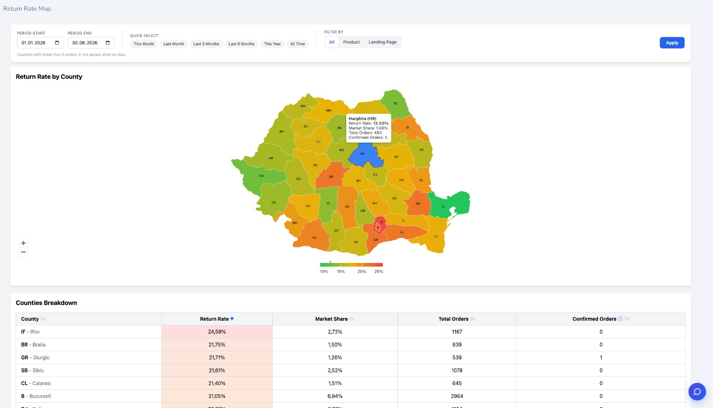

<Warning>
Acest dashboard este vizibil **doar pentru abonamentul Gold Plus** și pentru utilizatorii cu permisiunea `dashboard.return-rate-map.index`.
</Warning>

Pagina **Hartă Rată Retur** (Return Rate Map) din secțiunea **Analiză** oferă o vizualizare geografică a ratei de retur pe județe pentru comenzile din România.

<Frame>
  
</Frame>

## Harta

Harta afișează România împărțită pe județe. Comutatorul din dreapta sus alege ce colorează harta:

- **Rată Retur** - de la verde (cea mai mică rată din perioada aleasă) prin galben până la roșu (cea mai mare)
- **Cotă de Piață** - ponderea județului în totalul comenzilor

<Info>
Culorile sunt relative: se calculează între cea mai mică și cea mai mare valoare din perioada și filtrele alese, nu după praguri fixe. Județele cu mai puțin de **5 comenzi** în perioadă nu afișează date.
</Info>

Când treci cu mouse-ul peste un județ vezi: rata de retur, cota de piață, totalul comenzilor, comenzile încă în status **Confirmed** (fără informații despre livrare sau retur) și, dacă ai folosit mai mulți curieri, **Distribuție Curieri** (procentul și numărul de comenzi pe fiecare curier).

## Filtre

- **Început Perioadă / Sfârșit Perioadă** și **Selecție Rapidă**: Luna Aceasta, Luna Trecută, Ultimele 3 Luni, Ultimele 6 Luni, Anul Acesta, Tot Timpul
- **Filtrare după**: Toate (implicit), **Produs** sau **Landing Page**
- **Filtru Curier**: toți curierii sau doar unul

Apasă **Aplică** după ce schimbi filtrele.

<Tip>
Folosește filtrele pentru a identifica produsele sau landing page-urile cu rate de retur ridicate în anumite zone geografice, iar filtrul de curier ca să vezi dacă problema ține de curier.
</Tip>

## Detaliere pe Județe

Tabelul de sub hartă are câte un rând pentru fiecare județ. Click pe antetul unei coloane sortează tabelul.

| Coloană | Ce arată |
|---|---|
| **Județ** | Codul și numele județului |
| **Rată Retur** | Procentul comenzilor returnate |
| **Cotă de Piață** | Ponderea județului în totalul comenzilor |
| **Impact** | Rata de retur × cota de piață: comenzile returnate din județ ca procent din volumul total. Arată unde reducerea retururilor ar avea cel mai mare efect |
| **Total Comenzi** | Numărul de comenzi din perioadă (iconița 🚚 arată distribuția pe curieri) |
| **Comenzi Confirmate** | Comenzi încă în status **Confirmed** |
| **Curier** | Curierul implicit pentru comenzile din acest județ (vezi mai jos) |
| **Vezi** | Deschide pagina de detaliu a județului |

### Curierul pe județ

Din coloana **Curier** poți alege un curier pentru fiecare județ. Curierul ales este propus automat în ecranul de [confirmare a comenzii](/crm/orders#order-confirm) pentru comenzile din acel județ. Opțiunea **Implicit** folosește curierul obișnuit.

### Detaliu Județ

Butonul **Vezi** (disponibil doar cu filtrul **Toate**) deschide o pagină cu comenzile returnate din județ și detalierea ratei de retur **pe produs**, **pe landing page** și **pe curier**, pentru perioada și curierul alese. Detalierea pe curier te ajută să vezi dacă rata de retur din județ ține de curier sau de alți factori.
